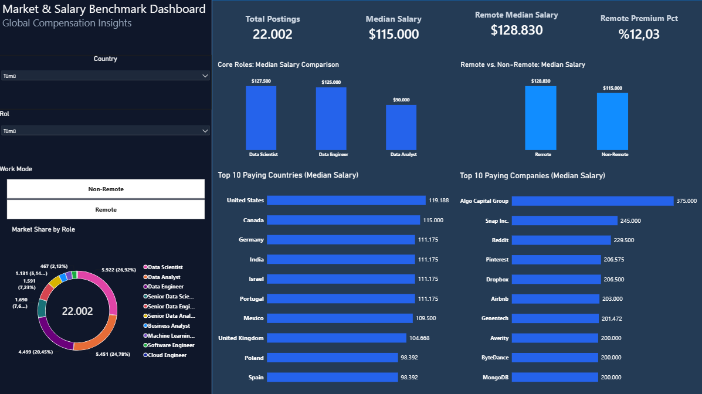

# Global Tech Salary Benchmark & Executive Talent Dashboard

An end-to-end data analytics project combining PostgreSQL data modeling with an Executive Power BI Dashboard to evaluate compensation benchmarks, geographic wage disparities, and remote work premiums across 22,000+ technical job postings.

---

## Executive Dashboard Overview



---

## Executive Summary & Key Metrics

* **Total Verified Records:** 22,002 job postings across international markets.
* **Global Median Salary:** \$115,000 baseline calculated via non-parametric medians (`PERCENTILE_CONT`).
* **Remote Work Premium:** Remote positions command a +12.03% compensation premium (\$128,830 vs. \$115,000).
* **Role Compensation Hierarchy:**
  * Data Scientist: \$127,500
  * Data Engineer: \$125,000
  * Data Analyst: \$90,000
* **Top Paying Geographies:** United States (\$119,188), Canada (\$115,000), and Germany (\$111,175) among jurisdictions meeting statistical reliability criteria ($N \ge 100$).
* **Top Paying Employers:** Algo Capital Group (\$375,000), Snap Inc. (\$245,000), and Reddit (\$229,500) lead compensation among organizations with $N \ge 10$ postings.

---

## Technical Stack & Methodology

* **Database Engine:** PostgreSQL (Common Table Expressions, Window Functions, `PERCENTILE_CONT`, Aggregate Filtering).
* **Business Intelligence:** Microsoft Power BI Desktop.
* **Data Modeling & DAX:** Custom measures for non-parametric central tendency, cohort ratio distributions, and compensation variance.
* **Dashboard Architecture:** Dark executive theme optimized for readability, adhering to Edward Tufte's data-ink ratio by removing non-essential gridlines and integrating explicit data labels.

---

## Analytical Architecture: SQL to Power BI Mapping

| Analysis Dimension | SQL Implementation | Power BI & DAX Alignment |
| :--- | :--- | :--- |
| **Global Compensation Baseline** | `PERCENTILE_CONT(0.5) WITHIN GROUP (ORDER BY salary_year_avg)` | Reconciled against `Median Salary` measure (\$115,000) |
| **Remote Premium Quantification** | Segmented CTE evaluating `job_work_from_home` boolean flags | Calculated via `work_mode` dimension (\$128,830 vs. \$115,000) |
| **Role Volume Distribution** | `COUNT(*)` aggregations with relative window percentages | Interactive Donut visual monitoring 22,002 postings |
| **Geographic Filtering** | Sample threshold filtering via `HAVING COUNT(*) >= 100` | Filtered horizontal ranking displaying Top 10 countries |
| **Enterprise Compensation** | Sample threshold filtering via `COUNT(*) >= 10` with deterministic sorting | Ranked bar chart identifying top-paying organizations |

---

## Repository Structure

```text
├── sql/
│   ├── 01_remote_salary_analysis.sql
│   ├── 02_top_paying_countries.sql
│   ├── 03_market_share_by_role.sql
│   └── 04_top_paying_companies.sql
├── dashboard_overview.png
├── tech_salary_dashboard.pbix
└── README.md
'''
---

## Author
* **Furkan Özer** - Graduate Researcher / Data Analyst
* Portfolio Project: End-to-End SQL & Power BI Implementation
